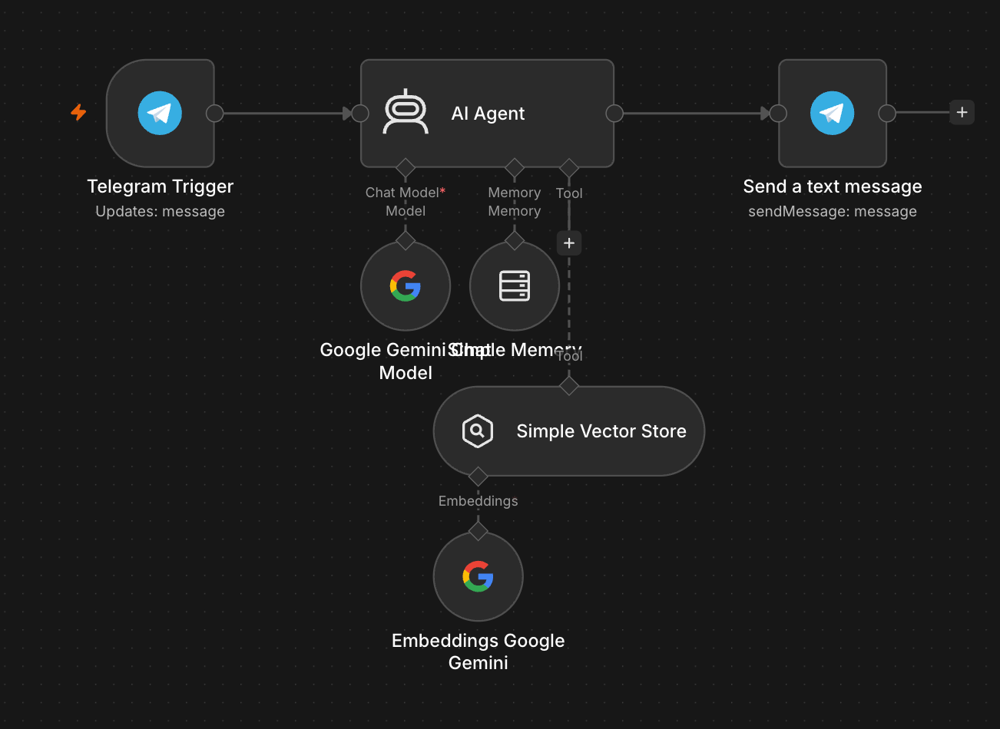
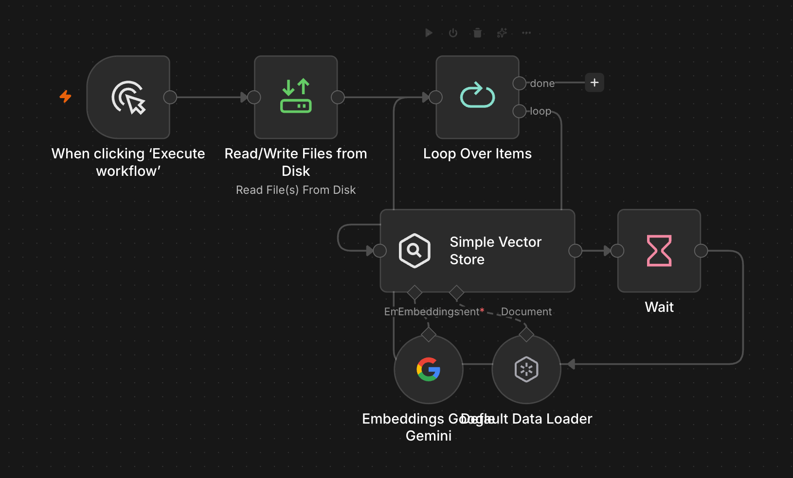

# Corezoid Docs Mentor Bot — RAG in n8n

A Telegram bot that answers questions about [Corezoid](https://corezoid.com) (BPM platform) **using only Corezoid's own documentation**, and explains each answer through analogies with n8n. Built in n8n with Gemini embeddings and a vector store, then evaluated on a fixed question set.

The point of the project is not the bot itself, but the **RAG pipeline end to end**: ingestion, retrieval, grounding, evaluation, and debugging of the failures that showed up along the way.

> Status: working prototype, self-hosted, vector store lives in memory. See [Limitations](#limitations).

---

## What it does

- Answers in Telegram, keeps a per-chat conversation memory.
- Corezoid facts (node types, fields, error codes, built-in functions) come **only from retrieved documentation fragments**; the model is told to refuse to invent identifiers.
- Cites the source files it used.
- Politely refuses off-topic questions (e.g. weather).

## Architecture

```
INGEST (run manually, once)
Manual Trigger
  → Read Files from Disk      (45 Markdown files, ~520 KB)
  → Loop Over Items           (batch = 3 files)
      → Simple Vector Store   (Insert; Gemini embeddings; default text splitter)
      → Wait 60 s             (rate-limit throttle)
  → loop back

QUERY (live, via Telegram webhook)
Telegram Trigger
  → AI Agent
        ├─ Chat model: Google Gemini
        ├─ Memory: Simple Memory (session key = Telegram chat id)
        └─ Tool: Simple Vector Store (Retrieve, Gemini embeddings, limit = 5)
  → Telegram: Send a text message   (Parse Mode = HTML, text HTML-escaped)
```

| Component | Choice |
|---|---|
| Orchestration | n8n 2.x, self-hosted in Docker |
| LLM | Google Gemini (chat) |
| Embeddings | Google Gemini embeddings (3072-dim vectors) |
| Vector store | n8n *Simple Vector Store* (in memory) |
| Corpus | 45 Markdown docs from the MIT-licensed `corezoid-ai-plugin` repository, split into 618 chunks |
| Delivery | Telegram bot, public webhook through an ngrok tunnel |

### Screenshots

**Query workflow (Telegram agent with retrieval tool)**



**Ingestion workflow (throttled loop)**



## Quick start

> Secrets (bot token, Gemini key, ngrok token) are **never** stored in the exported workflows. Create them as n8n credentials.

1. **Tunnel** (Telegram needs a public HTTPS URL):
   ```bash
   ngrok http --url=<your-static-domain>.ngrok-free.dev 5678
   ```
2. **n8n in Docker**, with the docs mounted read-only inside n8n's allowed files directory:
   ```bash
   docker run -d --name n8n --restart unless-stopped -p 5678:5678 \
     -e WEBHOOK_URL=https://<your-static-domain>.ngrok-free.dev/ \
     -v n8n_data:/home/node/.n8n \
     -v /path/to/corezoid/docs:/home/node/.n8n-files/corezoid-docs:ro \
     docker.n8n.io/n8nio/n8n
   ```
3. **Credentials** in n8n: *Telegram API* (token from @BotFather) and *Google Gemini (PaLM) API*.
4. **Import** `workflows/corezoid-docs-ingest.json` and `workflows/bot-telegram.json`, then select your own credentials in the Telegram and Google Gemini nodes (credential references are stripped from the exports). Both workflows use the vector store key `corezoid_docs_v2`.
5. **Ingest**: run the ingest workflow and wait until the loop finishes (~15 minutes, see [Finding 1](#finding-1-silent-ingestion-failure)).
6. **Publish** the bot workflow and message your bot.

The vector store is in memory: restarting the n8n container requires running the ingest workflow again.

## Agent system prompt (summary)

- Role: mentor on n8n for a Corezoid developer, short answers in Russian.
- Scope: only n8n and Corezoid questions.
- Grounding: answer about Corezoid **only** from the retrieval tool; name only fields/functions that appear verbatim in retrieved text; never extend a list that was cut off.
- Retrieval hygiene: put the full node name in the search query; verify `type` values and identifiers verbatim; ignore fragments that belong to a different node; up to 3 searches.
- Output: plain text, no Markdown, max ~1500 characters, list only sources actually used.

## Evaluation

A fixed question set with a reference answer for each (expected source file, expected facts, known trap). Each answer was checked for: correct source in the retrieved chunks, expected facts present, hallucinations.

**Main set (6 questions)**

| # | Question topic | Result |
|---|---|---|
| 1 | Fields of the Set Parameters node | 4/4 facts, no hallucination |
| 2 | Built-in functions of Set Parameters | all key functions listed, none invented |
| 3 | Minimum Delay time | 4/4 facts (static limit 30 s, dynamic absolute timestamp) |
| 4 | `type` of the Call a Process node | **failed at first** (`api_copy` instead of `api_rpc`), correct after prompt fix |
| 5 | Condition node without a default branch | 3/3 facts |
| 6 | Off-topic (weather) | correctly refused |

**Held-out set (questions added after tuning)**

| Question topic | Result |
|---|---|
| `type` of Waiting for Callback | correct (`api_callback`), missed one detail (public callback URL) |
| Modify Task implementation | correct (`api_copy` with `mode: "modify"`), 4/4 facts |

The prompt fix for question 4 was tailored to that failure, which is why the held-out questions exist: they check that it generalizes. The sample is small (8 questions), so treat this as a smoke test, not a benchmark.

Progression for question 1: no retrieval → 1/4 facts and a wrong claim; broken vector store → 2/4 facts and an invented function (`$.now()`); fixed pipeline → 4/4 facts, sources cited.

## Findings

### Finding 1: silent ingestion failure

Symptom: "poor retrieval quality", the right file never appeared in results, even for a verbatim quote from it.

Cause (found by inspecting the stored execution data, not by guessing): of 618 chunks only the **first 100 had real embeddings**; the other 518 had empty vectors. Every node was green and reported "618 items". The behavior matches a free-tier embedding rate limit (about 100 texts per minute; observed, not confirmed in official docs). My first hypothesis (batch size) was wrong: reducing the batch from 200 to 50 left exactly the same 100 valid vectors.

Fix: process files in a loop (3 files per iteration) with a 60-second wait, into a fresh store key. Result: **618/618 non-empty vectors**.

Lesson: after ingestion, assert that the number of non-empty vectors equals the number of chunks.

### Finding 2: truncated chunks make the model hallucinate

A retrieved chunk ended right before a list of functions ("…directly within parameter values:"). The list itself was in the next chunk, which was not retrieved, and the model completed it with a plausible invented function. Mitigations: grounding rules in the prompt, allowing repeated searches, and (planned) larger chunks / title-aware chunks.

### Finding 3: exact identifiers are weak spots for vector search

For "`type` of Call a Process" retrieval returned a chunk about Modify Task with `"type": "api_copy"`, and the model answered from it. The right chunk (`api_rpc`) did not contain the words "Call a Process" because its heading ended up in the previous chunk. Vector similarity treats `api_rpc` and `api_copy` as near-synonyms. Mitigations: put the node name in the search query (prompt rule), planned: embed document/section title with each chunk and add keyword (hybrid) search.

### Finding 4: model-cited sources are not proof

The model listed a source file that was not in the retrieved results of that run. Cited sources must be checked against what the retrieval tool actually returned.

### Finding 5: messenger boundary

Telegram rejected answers (`can't parse entities`) because snake_case identifiers like `err_node_id` break Markdown parsing, and n8n's Telegram node uses Markdown unless Parse Mode is set explicitly. Fix: Parse Mode = HTML, with `&`, `<`, `>` escaped in the text. Also keep answers under Telegram's 4096-character limit.

## Limitations

- **Only the Corezoid side is grounded.** The n8n analogies come from the model's memory, because n8n documentation is not in the knowledge base. Earlier in the project the model confidently stated a wrong default for an n8n option.
- **In-memory vector store**: lost on restart; no persistence or incremental updates.
- **Plain vector search only**; no keyword/hybrid retrieval or reranking.
- **Small evaluation set** (8 questions) and single runs; LLM output varies between runs.
- **Free-tier API quotas** shape the ingestion design.
- Documentation inconsistencies in the source corpus (e.g. differing Git Call type names across files) are inherited by the bot.

## Next steps

1. Re-implement the same pipeline in code (LlamaIndex) and compare results with the n8n version on the same question set.
2. Title-aware chunks and hybrid search to address exact-identifier misses.
3. Add n8n documentation to the knowledge base to ground the analogies.
4. Persistent vector store (Qdrant in Docker); incremental re-ingestion.
5. Automated evaluation: run the question set on every change and report retrieval hit rate and fact coverage.

## Repository layout

```
workflows/
  corezoid-docs-ingest.json     # ingestion loop
  bot-telegram.json             # Telegram agent workflow
docs/
  architecture-bot.png          # query workflow screenshot
  architecture-ingest.png       # ingestion workflow screenshot
  evaluation.md                 # full question set with reference answers (optional)
README.md
```

## Credits

Corezoid documentation: `corezoid/corezoid-ai-plugin` (MIT). This project is an independent learning exercise and is not affiliated with Corezoid.
